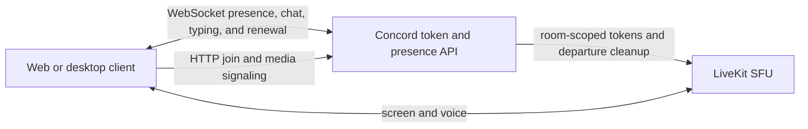

<p align="center">

> Media backend: set `MEDIA_PROVIDER=livekit` or `MEDIA_PROVIDER=cloudflare` in
> the server `.env`. Both modes publish a single video encoding per screen.
> See [media configuration](docs/livekit.md) for required credentials and switching.

  
</p>

<p align="center">
  <strong>English</strong> · <a href="README.pt-BR.md">Português do Brasil</a>
</p>

<p align="center">
  A private, lightweight room for sharing your screen, talking, and exchanging ephemeral messages.
</p>

<p align="center">
  <a href="https://github.com/Jovem-Blood/Concord/releases/latest"></a>
  <a href="https://github.com/Jovem-Blood/Concord/actions/workflows/ci.yml"></a>
  
  
</p>

> [!NOTE]
> Concord is an early-stage project. Media uses LiveKit Cloud or a reachable self-hosted LiveKit server.

## Why Concord?

Concord is designed for small groups that need a room quickly—not another account, community, or permanent workspace. A room is accessed through its code or invite link and combines screen sharing, voice, and ephemeral chat in the same focused interface.

- No accounts, camera, recording, permanent message history, attachments, or direct messages.
- Web and desktop clients share the same Vue renderer and can join the same room.
- Media travels through LiveKit. Chat, presence, and typing use a dedicated Socket.IO WebSocket connection to the Concord API.
- The desktop app is available for Windows and Linux, with a self-hostable web client.

## Features

- Create or join a private room by code or invite link.
- Share multiple screens at once, focus a stream, and see who is in the room.
- Native desktop source picker with monitor/window previews.
- Selectable `720p30` (default) and `1080p30` capture resolutions with a fixed 30 FPS rate.
- Optional system audio, disabled by default.
- Real-time microphone audio, mute controls, room audio controls, and local speaking feedback.
- Ordered text chat: up to 2,000 characters per message and the latest 500 messages available to new and returning participants. History is deleted when the last live socket disconnects or the API restarts; nothing is written to disk.
- Typing indicators, pending/sent/failed message feedback, duplicate-safe retries, and editable offline drafts.
- Automatic SFU session recovery, active-source republishing, and remote stream resubscription.
- Up to 16 participants per room.
- Portable ZIPs plus Windows NSIS and Linux AppImage releases.

## Download

Download the latest desktop build from [GitHub Releases](https://github.com/Jovem-Blood/Concord/releases/latest).

| Platform | Packages |
|---|---|
| Windows x64 | NSIS installer and portable ZIP |
| Linux x64 | AppImage and portable ZIP |
| Web | Self-hosted build from this repository |

Windows artifacts are currently unsigned and may trigger a Microsoft SmartScreen warning. Portable ZIP builds do not self-update; installed NSIS and AppImage builds check GitHub Releases for updates.

On desktop, the **Atualizações** panel shows the installed version, download progress, and errors with a retry action. Checks run at startup, every four hours, and through **Verificar atualizações**. Stable releases download automatically and install when Concord closes, or through **Reiniciar para atualizar**. Leave the room before using that button; downloading an update does not restart an ongoing call. On Linux, run the AppImage from a user-writable directory.

Releases must include the generated update metadata (`latest.yml` on Windows and `latest-linux.yml` on Linux), installers, and generated blockmaps. The updater verifies the metadata's SHA-512; `SHA256SUMS.txt` is for manual verification. Older builds without an updater and portable ZIPs require an initial manual installation.

## How it works



The server `RoomAuthority` owns membership, credentials and chat. `RoomSession` coordinates Socket.IO and the server-selected media provider: LiveKit SDK or Concord Cloudflare SFU integration. Both publish one video encoding per screen with the selected 720p/1080p ceiling. Simulcast, tile-based layer selection and LiveKit Dynacast/adaptive subscriptions are disabled. Microphone preparation and media recovery are retained.

Participant credentials rotate automatically before their two-hour expiry. Unexpected connection loss reserves the participant's identity and room slot for 30 seconds after detection (heartbeats take approximately 15 seconds to detect a silent failure). Working media continues during recovery, then stops if recovery expires. Refresh/Leave requires an explicit rejoin. A disconnected last participant does **not** preserve history during the recovery window: their next connection starts a new conversation. Run a single API instance; an API restart clears rooms and requires rejoining.

See [LiveKit integration](docs/livekit.md) and [Realtime lifecycle](docs/realtime.md). Protocol v4 requires updating the API, web and desktop clients together. Cloudflare Tunnel can still expose the Concord HTTP/WebSocket server; media connects directly to LiveKit Cloud without home port forwarding.

## Quick start

### Requirements

- Node.js `22.12+` for development; Node.js 24 LTS is recommended and required by the release workflow.
- pnpm `10.15.0`.
- A LiveKit Cloud project or reachable self-hosted LiveKit server.
- Windows 11 x64 for native Windows capture testing, or a current browser with `getDisplayMedia` and HTTPS outside localhost.

### 1. Configure the environment

Copy `.env.example` to `.env` without replacing an existing local file. Set your LiveKit project credentials:

```dotenv
LIVEKIT_URL=wss://your-project.livekit.cloud
LIVEKIT_API_KEY=your_api_key
LIVEKIT_API_SECRET=your_api_secret
```

Never place secrets in a `VITE_` variable; those values are embedded into client builds.

### 2. Install and run

```sh
pnpm install
pnpm dev:server
```

In another terminal, start either client:

```sh
pnpm dev:web       # http://localhost:5173
pnpm dev:desktop   # Electron
```

An invite such as `http://localhost:5173/ABCD2345` prepares the client to join that room.

### Docker

```sh
docker compose up --build
```

Open `http://localhost:4173`. Compose loads the root `.env` and binds both services to loopback. Development media uses the configured LiveKit project. Unit tests use mocks and need no credentials.

### Production through a tunnel

Run `./scripts/setup-self-host.sh concord.example.com` to prepare new environment files, fill in the SFU credentials, then start the same Compose file with `docker compose up -d --build`. The tunnel terminates HTTPS and replaces an additional reverse proxy. Route requests as follows:

| Public route | Origin on the host |
|---|---|
| `/health`, `/v1/*` | `http://127.0.0.1:3001` |
| All other routes | `http://127.0.0.1:4173` |

Do not cache `/v1/*`. If the tunnel does not support path-based routing, use a separate API hostname and set `PUBLIC_SERVER_URL` before building. `ALLOWED_ORIGINS` must include the public web origin. A tunnel running in a container can join the Compose network and use `http://server:3001` and `http://web:4173` directly.

Run exactly one `server` instance: room presence, tokens, and publications are kept in memory, and restarting it ends the active room sessions.

## Configuration

| Variable | Purpose |
|---|---|
| `LIVEKIT_URL` | LiveKit WebSocket URL (`wss://...`) |
| `LIVEKIT_API_KEY` | Server-side LiveKit API key |
| `LIVEKIT_API_SECRET` | Server-side LiveKit API secret |
| `ALLOWED_ORIGINS` | Comma-separated web origins accepted by the API |
| `PORT` | API port; defaults to `3001` |
| `PUBLIC_APP_URL` | Public web URL used by Docker Compose |
| `PUBLIC_SERVER_URL` | Public API URL embedded in the Compose web build |
| `VITE_SERVER_URL` | API URL embedded in the client |
| `VITE_WEB_APP_URL` | Base URL used by desktop invite links |
| `LOG_LEVEL` | Server log threshold (`error`, `warn`, `info`, `debug`); defaults to `info` |
| `VITE_LOG_LEVEL` | Client console threshold; defaults to `info` |
| `MEDIA_DIAGNOSTICS_MAX_BYTES` | Total media diagnostics storage budget in bytes. The default is 16 MiB. Set to `0` to disable collection. |

During a screen share, clients send a WebRTC sample when video starts or reopens and then on each 15-second health check. They use the authenticated `POST /v1/media-diagnostics` endpoint. Samples contain the browser family and available resolution, frame, freeze and network counters. Temporary IDs allow comparing samples from the same room by time. The files contain technical data only and exclude screen content, audio and chat.

On the server, run `docker compose exec -T server cat /app/media-diagnostics/current.ndjson` to read recent samples. After the first rotation, `previous.ndjson` contains the preceding samples. Each file uses up to half the storage budget. The volume persists across container recreation.

OpenTelemetry export is optional and supports OTLP HTTP/protobuf, HTTP/JSON and gRPC destinations. Without a configured endpoint it stays disabled. A separate Grafana Compose reference includes traces, logs, metrics, a dashboard and alert rules. See [Optional observability](docs/observability.md) for setup, existing-backend integration and notification configuration.

Server logs are structured JSON. The client reports errors, warnings, connection loss and recovery to `/v1/client-events`; a bounded in-memory queue retries reports after connectivity returns. Reports contain an ephemeral client ID, platform, event, severity and limited error classification. They do not include room codes, names, tokens, SDP or chat content. Events queued when the app closes are lost.

LiveKit provides ICE/TURN configuration to its SDK. Cloudflare TURN credentials are not used by the LiveKit client. Web capture audio availability depends on the browser, operating system and selected source; video continues with a warning when audio is unavailable.

## Development

```sh
pnpm typecheck
pnpm test
pnpm lint
pnpm build
pnpm make
```

The web build is written to `apps/client/dist-web`. `pnpm make` builds release artifacts for the current operating system and requires Node.js 22.12 through 24.x; Node.js 24 LTS is recommended.

Useful project references:

- [Manual test checklist](docs/manual-test-checklist.md)
- [Design guide](design.md)
- [Contributing guide](CONTRIBUTING.md)
- [Security policy](SECURITY.md)

## Releases

CI runs type checks, tests, lint, web/server builds, and Docker builds on pushes
to `main` and pull requests. Deployment to the self-hosted machine is manual.
The download reflects the latest tagged release; `main` may include newer work.

Desktop, web and API must use room protocol 5 for LiveKit media. Older clients receive an update-required response. See [release notes](CHANGELOG.md).

SemVer tags such as `v1.0.0` trigger `.github/workflows/release.yml`. The tag must match `apps/client/package.json` and point to a commit contained in `main`. The workflow verifies the project, builds Windows and Linux artifacts, generates SHA-256 checksums, and publishes a GitHub Release.

## Privacy and security

Electron runs with `nodeIntegration: false`, `contextIsolation: true`, sandboxing, and a restrictive Content Security Policy. Its preload exposes only capture operations and clipboard text writing. Capture selections are tied to the requesting window, expire after ten seconds, and are consumed once.

The microphone is requested when joining a room and prepared while muted, so unmuting can reuse the existing audio publication. Denying permission does not prevent joining; the microphone control can retry later. No camera is enabled. Chat history is kept only in API memory, limited to the latest 500 messages, and can be recovered when joining or reconnecting while the conversation remains active. It is deleted immediately when the last active connection drops or the API restarts; nothing is written to disk. If credentials expire without renewal or the recovery window ends, all active capture stops and joining again is required.

Please report vulnerabilities privately according to [SECURITY.md](SECURITY.md).

## Deliberate limits

Concord does not currently provide cameras, user accounts, recording, persistent history, attachments, direct messages, process-specific Windows audio, or automatic multi-instance API coordination. The current implementation uses one video layer with profile-specific bitrate limits rather than simulcast.

## Contributing

Issues and pull requests are welcome. Read [CONTRIBUTING.md](CONTRIBUTING.md) before starting, and use the manual checklist for changes involving capture, media, or cross-device behavior.

## License

Concord is available under the [MIT License](LICENSE). Bundled fonts retain their
[own license](apps/client/src/renderer/assets/fonts/LICENSE.txt).
