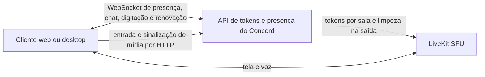

<p align="center">

> Media backend: set `MEDIA_PROVIDER=livekit` or `MEDIA_PROVIDER=cloudflare` in
> the server `.env`. Both modes publish a single video encoding per screen.
> See [media configuration](docs/livekit.md) for required credentials and switching.

  
</p>

<p align="center">
  <a href="README.md">English</a> · <strong>Português do Brasil</strong>
</p>

<p align="center">
  Uma sala privada e leve para compartilhar sua tela, conversar por voz e trocar mensagens efêmeras.
</p>

<p align="center">
  <a href="https://github.com/Jovem-Blood/Concord/releases/latest"></a>
  <a href="https://github.com/Jovem-Blood/Concord/actions/workflows/ci.yml"></a>
  
  
</p>

> [!NOTE]
> O Concord está em fase inicial. A mídia usa LiveKit Cloud ou um servidor LiveKit próprio acessível aos clientes.

## Por que Concord?

O Concord foi feito para pequenos grupos que precisam de uma sala rapidamente — não de mais uma conta, comunidade ou espaço permanente. O acesso acontece por código ou link de convite e reúne compartilhamento de tela, voz e chat efêmero em uma interface focada.

- Sem contas, câmera, gravação, histórico permanente de mensagens, anexos ou mensagens diretas.
- Clientes web e desktop usam o mesmo renderer Vue e entram na mesma sala.
- A mídia passa pelo LiveKit. Chat, presença e digitação usam uma conexão Socket.IO dedicada, somente por WebSocket, com a API do Concord.
- O aplicativo desktop está disponível para Windows e Linux, com cliente web auto-hospedável.

## Recursos

- Criação e entrada em sala privada por código ou link de convite.
- Várias telas simultâneas, foco em um stream e lista de participantes.
- Seletor nativo de fontes no desktop com miniaturas de monitores e janelas.
- Resoluções de captura selecionáveis em `720p30` (padrão) e `1080p30`, sempre a 30 FPS.
- Áudio do sistema opcional, desligado por padrão.
- Microfone em tempo real, mute, silenciar sala e indicador local de fala.
- Chat de texto ordenado: até 2.000 caracteres por mensagem e as últimas 500 mensagens disponíveis para quem entrar ou reconectar. O histórico é apagado quando a última conexão ativa cai ou a API reinicia; nada é gravado em disco.
- Indicadores de digitação, mensagens pendentes/enviadas/com falha, reenvio sem duplicatas e rascunhos editáveis offline.
- Recuperação automática da sessão SFU, republicação das fontes ativas e reassinatura dos streams remotos.
- Até 16 participantes por sala.
- ZIPs portáteis, instalador NSIS para Windows e AppImage para Linux.

## Download

Baixe a versão desktop mais recente em [GitHub Releases](https://github.com/Jovem-Blood/Concord/releases/latest).

| Plataforma | Pacotes |
|---|---|
| Windows x64 | Instalador NSIS e ZIP portátil |
| Linux x64 | AppImage e ZIP portátil |
| Web | Build auto-hospedado deste repositório |

Os artefatos do Windows ainda não são assinados e podem exibir um aviso do Microsoft SmartScreen. Os ZIPs portáteis não se atualizam sozinhos; instalações NSIS e AppImage verificam novas versões no GitHub Releases.

No desktop, o painel **Atualizações** mostra a versão instalada, progresso do download e falhas com opção de tentar novamente. A verificação ocorre ao abrir o aplicativo, a cada quatro horas e pelo botão **Verificar atualizações**. Versões estáveis são baixadas automaticamente e instaladas ao fechar o Concord, ou pelo botão **Reiniciar para atualizar**. Saia da sala antes de usar esse botão; o download não reinicia o aplicativo durante uma chamada. No Linux, execute o AppImage em um diretório onde seu usuário tenha permissão de escrita.

As releases precisam incluir os metadados gerados pelo empacotamento (`latest.yml` no Windows e `latest-linux.yml` no Linux), além dos instaladores e blockmaps gerados. O atualizador valida o SHA-512 dos metadados; `SHA256SUMS.txt` serve para conferência manual. Builds antigos sem atualizador e ZIPs precisam de instalação manual inicial.

## Como funciona



A `RoomAuthority` controla participantes, credenciais e chat. A `RoomSession` coordena Socket.IO e o provedor escolhido no servidor: SDK LiveKit ou integração Cloudflare SFU do Concord. Ambos publicam apenas uma versão de vídeo por tela, com teto de 720p/1080p. Simulcast, seleção de camadas por tamanho e Dynacast/assinaturas adaptativas do LiveKit estão desativados. A preparação do microfone e a recuperação de mídia foram preservadas.

As credenciais são renovadas automaticamente antes de expirar em duas horas. Uma queda inesperada reserva a identidade e a vaga por 30 segundos após a detecção (até aproximadamente 15 segundos de heartbeat para detectar uma falha silenciosa). A mídia continua durante a recuperação e para se o prazo expirar. Recarregar/sair exige entrar novamente. A última conexão cair apaga o histórico imediatamente, mesmo durante a reserva de reconexão. Execute uma única instância da API; reiniciá-la apaga as salas e exige entrar novamente.

Consulte [Integração LiveKit](docs/livekit.md) e [Ciclo de vida em tempo real](docs/realtime.md). O protocolo v4 exige atualizar API, web e desktop juntos. O Cloudflare Tunnel continua servindo a API; a mídia se conecta diretamente ao LiveKit Cloud, sem abrir portas na rede doméstica.

## Início rápido

### Requisitos

- Node.js `22.12+` para desenvolvimento; Node.js 24 LTS é recomendado e usado no workflow de release.
- pnpm `10.15.0`.
- Um projeto LiveKit Cloud ou servidor LiveKit próprio acessível.
- Windows 11 x64 para testes de captura nativa no Windows, ou navegador atual com `getDisplayMedia` e HTTPS fora de localhost.

### 1. Configure o ambiente

Copie `.env.example` para `.env` sem substituir um arquivo local existente e configure o projeto LiveKit:

```dotenv
LIVEKIT_URL=wss://seu-projeto.livekit.cloud
LIVEKIT_API_KEY=sua_api_key
LIVEKIT_API_SECRET=seu_api_secret
```

Nunca coloque segredos em variáveis `VITE_`; esses valores são incorporados aos builds do cliente.

### 2. Instale e execute

```sh
pnpm install
pnpm dev:server
```

Em outro terminal, inicie um dos clientes:

```sh
pnpm dev:web       # http://localhost:5173
pnpm dev:desktop   # Electron
```

Um convite como `http://localhost:5173/ABCD2345` prepara o cliente para entrar nessa sala.

### Docker

```sh
docker compose up --build
```

Abra `http://localhost:4173`. O Compose carrega o `.env` da raiz e prende os serviços ao loopback. A mídia de desenvolvimento usa o projeto LiveKit configurado. Os testes unitários usam mocks e não precisam de credenciais.

### Produção por túnel

Execute `./scripts/setup-self-host.sh concord.example.com` para preparar novos arquivos de ambiente, preencha as credenciais SFU e inicie o mesmo Compose com `docker compose up -d --build`. O túnel termina HTTPS e substitui um proxy reverso adicional. Distribua as requisições assim:

| Rota pública | Origem no host |
|---|---|
| `/health`, `/v1/*` | `http://127.0.0.1:3001` |
| Demais rotas | `http://127.0.0.1:4173` |

Não faça cache de `/v1/*`. Se o túnel não aceitar regras por caminho, use um hostname separado para a API e defina `PUBLIC_SERVER_URL` antes do build. `ALLOWED_ORIGINS` deve incluir a origem pública do web. Um túnel executado em contêiner pode entrar na rede do Compose e acessar diretamente `http://server:3001` e `http://web:4173`.

Execute exatamente uma instância de `server`: presença, tokens e publicações ficam em memória, e reiniciá-la encerra as sessões de sala ativas.

## Configuração

| Variável | Uso |
|---|---|
| `LIVEKIT_URL` | URL WebSocket do LiveKit (`wss://...`) |
| `LIVEKIT_API_KEY` | Chave de API LiveKit no servidor |
| `LIVEKIT_API_SECRET` | Segredo de API LiveKit no servidor |
| `ALLOWED_ORIGINS` | Origens web aceitas pela API, separadas por vírgula |
| `PORT` | Porta da API; padrão `3001` |
| `PUBLIC_APP_URL` | URL pública do web usada pelo Docker Compose |
| `PUBLIC_SERVER_URL` | URL pública da API incorporada ao build web do Compose |
| `VITE_SERVER_URL` | URL da API incorporada ao cliente |
| `VITE_WEB_APP_URL` | URL-base usada nos convites copiados pelo desktop |
| `LOG_LEVEL` | Nível mínimo dos logs do servidor (`error`, `warn`, `info`, `debug`); padrão `info` |
| `VITE_LOG_LEVEL` | Nível mínimo do console do cliente; padrão `info` |
| `MEDIA_DIAGNOSTICS_MAX_BYTES` | Teto total dos arquivos de diagnóstico de mídia em bytes. O padrão é 16 MiB e `0` desativa a coleta. |

Durante um compartilhamento, os clientes enviam uma amostra de WebRTC ao iniciar ou reabrir o vídeo e depois a cada healthcheck de 15 segundos. O envio usa `POST /v1/media-diagnostics` com a sessão da sala. As amostras registram família do navegador, resolução, quadros, congelamentos e contadores de rede disponíveis. IDs temporários permitem comparar os lados da mesma sala por horário. Os arquivos contêm apenas dados técnicos e não gravam a tela, o som ou o chat.

No servidor, use `docker compose exec -T server cat /app/media-diagnostics/current.ndjson` para ler as amostras recentes. Após a primeira rotação, `previous.ndjson` contém as anteriores. Cada arquivo usa até metade do teto. O volume persiste quando o contêiner é recriado.

A exportação OpenTelemetry é opcional e aceita destinos OTLP por HTTP/protobuf, HTTP/JSON ou gRPC. Sem endpoint configurado, fica desativada. Há um Compose Grafana separado, com traces, logs, métricas, dashboard e regras de alerta. Veja [Observabilidade opcional](docs/observability.md) para ativar, conectar sua própria stack e configurar notificações.

Os logs do servidor são JSON estruturado. O cliente envia erros, avisos, perda de conexão e recuperação para `/v1/client-events`; uma fila limitada em memória tenta reenviar quando a conexão volta. Os relatos contêm ID temporário do cliente, plataforma, evento, nível e classificação limitada do erro. Não incluem código da sala, nome, token, SDP ou conteúdo do chat. Eventos pendentes se perdem ao fechar o aplicativo.

O LiveKit fornece a configuração ICE/TURN ao SDK. O cliente LiveKit não usa as credenciais TURN da Cloudflare. O áudio da captura web depende do navegador, sistema operacional e fonte escolhida; quando indisponível, o vídeo continua com um aviso.

## Desenvolvimento

```sh
pnpm typecheck
pnpm test
pnpm lint
pnpm build
pnpm make
```

O build web fica em `apps/client/dist-web`. `pnpm make` gera artefatos de release para o sistema operacional atual e exige Node.js 22.12 a 24.x; Node.js 24 LTS é recomendado.

Referências úteis do projeto:

- [Lista de testes manuais](docs/manual-test-checklist.pt-BR.md)
- [Guia de design](design.md)
- [Guia de contribuição](CONTRIBUTING.md)
- [Política de segurança](SECURITY.md)

## Releases

A CI executa checagem de tipos, testes, lint, builds web/servidor e builds Docker
em pushes para `main` e pull requests. O deploy na máquina auto-hospedada é manual.
O download corresponde à última release com tag; a `main` pode conter trabalho
mais recente.

Desktop, web e API precisam usar o protocolo de sala 3, que adiciona respostas e reações autenticadas às mensagens. Clientes antigos recebem da API uma resposta exigindo atualização. Veja as [notas da versão](CHANGELOG.md) para mudanças e limitações conhecidas.

Tags SemVer como `v1.0.0` executam `.github/workflows/release.yml`. A tag deve corresponder a `apps/client/package.json` e apontar para um commit presente em `main`. O workflow verifica o projeto, cria os artefatos de Windows e Linux, gera checksums SHA-256 e publica uma GitHub Release.

## Privacidade e segurança

O Electron usa `nodeIntegration: false`, `contextIsolation: true`, sandbox e uma Content Security Policy restritiva. O preload expõe apenas operações de captura e escrita de texto na área de transferência. Seleções de fonte são vinculadas à janela solicitante, expiram em dez segundos e são consumidas uma vez.

O microfone é solicitado ao entrar na sala e preparado enquanto silenciado, permitindo reutilizar a publicação de áudio ao ativá-lo. Negar a permissão não impede a entrada; o controle do microfone permite tentar novamente depois. Nenhuma câmera é ativada. O histórico do chat fica apenas na memória da API, limitado às últimas 500 mensagens, e pode ser recuperado ao entrar ou reconectar enquanto a conversa permanecer ativa. Ele é apagado imediatamente quando a última conexão ativa cai ou a API reinicia; nada é gravado em disco. Se as credenciais expirarem sem renovação ou o prazo de recuperação terminar, todas as capturas são encerradas e é necessário entrar novamente.

Relate vulnerabilidades de forma privada conforme [SECURITY.md](SECURITY.md).

## Limites intencionais

O Concord não oferece atualmente câmera, contas de usuário, gravação, histórico persistente, anexos, mensagens diretas, áudio de um processo específico no Windows ou coordenação automática entre várias instâncias da API. A implementação atual usa uma camada de vídeo com limites de bitrate por perfil, sem simulcast.

## Como contribuir

Issues e pull requests são bem-vindos. Leia [CONTRIBUTING.md](CONTRIBUTING.md) antes de começar e use a lista manual para mudanças que envolvam captura, mídia ou comportamento entre dispositivos.

## Licença

O Concord está disponível sob a [Licença MIT](LICENSE). As fontes incluídas mantêm
sua [própria licença](apps/client/src/renderer/assets/fonts/LICENSE.txt).
